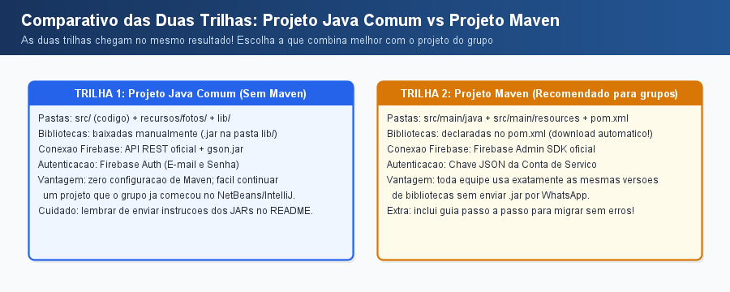
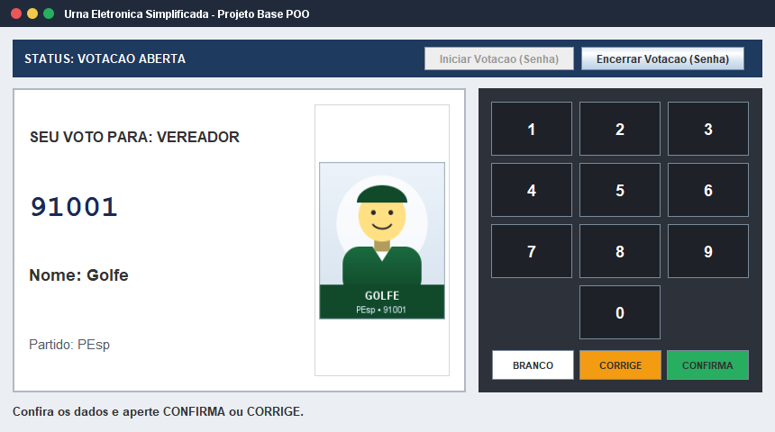
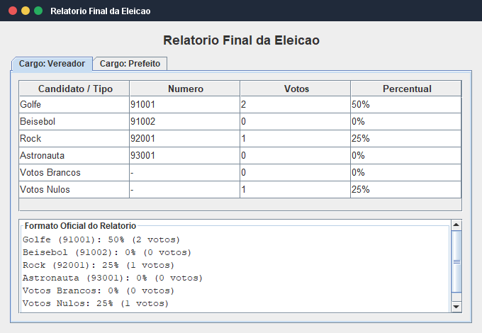

# 🗳️ Tutorial Completo: Urna Eletrônica em Java (Swing, JavaFX, Exceções, Maven e Firebase)

**Disciplina:** Programação Orientada a Objetos (POO)  
**Professor:** Nirton Afonso  
**Turmas:** Projeto de Extensão *Urna Cidadã* (Manhã) e Trabalho Final *AV3* (Noite)

---

## 📖 Leia o Tutorial Completo (Escolha como preferir acessar)

Todo o conteúdo das aulas — explicado passo a passo desde os conceitos fundamentais até a entrega final — está publicado em dois formatos idênticos e sincronizados:

- 👉 **[📚 Acessar a Wiki Oficial no GitHub](https://github.com/NirtonAfonso/Tutorial-Firebase/wiki)** *(recomendado para consultar junto com o código)*
- 👉 **[🌐 Acessar o Site do Tutorial (GitHub Pages)](https://nirtonafonso.github.io/Tutorial-Firebase/)** *(leitura rápida no navegador ou celular, com busca instantânea)*

---

## 🎯 O que você vai encontrar neste repositório?

Como não houve tempo hábil em sala de aula para cobrir todos os conteúdos necessários para o trabalho final, este repositório reúne **10 aulas completas** e **14 exemplos de código independentes, comentados e prontos para servir de base** nas duas abordagens:

- **Trilha 1 — Projeto Java Comum (sem Maven):** Para grupos que já iniciaram o projeto no IntelliJ ou NetBeans importando bibliotecas manualmente (`.jar`).
- **Trilha 2 — Projeto Maven:** Para grupos que desejam usar Maven (ou migrar o projeto atual para Maven com nosso passo a passo seguro).

---

## 📚 Índice das Aulas na Wiki

| # | Aula | Principais Assuntos |
| :---: | :--- | :--- |
| **01** | **[Projeto Java Comum (Sem Maven)](https://github.com/NirtonAfonso/Tutorial-Firebase/wiki/01-Projeto-Java-Comum)** | JDK/JVM, IntelliJ, NetBeans, fotos no classpath e adição manual de `.jar` |
| **02** | **[Projeto Maven e Migração](https://github.com/NirtonAfonso/Tutorial-Firebase/wiki/02-Projeto-Maven-e-Migracao)** | O que é Maven, `pom.xml`, vantagens, comandos e migração sem dor de cabeça |
| **03** | **[Java Swing e Interface da Urna](https://github.com/NirtonAfonso/Tutorial-Firebase/wiki/03-Java-Swing-e-Interface-da-Urna)** | `JFrame`, `JPanel`, Layouts, `ActionListener`, **foto automática ao completar os dígitos**, NetBeans GUI Builder vs IntelliJ |
| **04** | **[Tratamento de Exceções](https://github.com/NirtonAfonso/Tutorial-Firebase/wiki/04-Tratamento-de-Excecoes)** | Hierarquia `Throwable`, Checked vs Unchecked, `try/catch/finally`, `throw`/`throws`, exceções personalizadas e proteção da tela |
| **05** | **[Banco de Dados e Firebase](https://github.com/NirtonAfonso/Tutorial-Firebase/wiki/05-Banco-de-Dados-e-Firebase)** | Memória vs Persistência, SQL vs NoSQL, Cloud Firestore vs Realtime Database, Console Firebase e segurança com `.env` |
| **06** | **[Boas Práticas: MVC, `.env` e Proxy](https://github.com/NirtonAfonso/Tutorial-Firebase/wiki/06-Boas-Praticas-MVC-Env-e-Proxy)** | Arquitetura MVC, Padrão Proxy (`UrnaRepository`), leitura segura de `.env` e checklist da tabela de inspeção da AV3 |
| **07** | **[Conectando ao Firebase (Java Comum)](https://github.com/NirtonAfonso/Tutorial-Firebase/wiki/07-Conectando-Java-ao-Firebase-Sem-Maven)** | Firebase Authentication, `firestore.rules`, Gson, `FirestoreProxyRest` e Urna conectada |
| **08** | **[Conectando ao Firebase (Maven)](https://github.com/NirtonAfonso/Tutorial-Firebase/wiki/08-Conectando-Java-ao-Firebase-Com-Maven)** | Chave JSON de Conta de Serviço, `firebase-admin`, `FirebaseConexao`, `FirestoreProxy` e Urna conectada |
| **09** | **[JavaFX: Guia Prático](https://github.com/NirtonAfonso/Tutorial-Firebase/wiki/09-JavaFX-Guia-Pratico)** | Swing vs JavaFX, `Stage`, `Scene`, `GridPane`, `ImageView`, CSS, FXML e configuração com/sem Maven |
| **10** | **[Roteiro Final: AV3 e Extensão](https://github.com/NirtonAfonso/Tutorial-Firebase/wiki/10-Roteiro-do-Trabalho-AV3-e-Extensao)** | Projeto base MVC (2 cargos, senha `99999`, zerésima e apuração), checklist de entrega e apresentação |

---

## 📁 Mapa dos Códigos de Exemplo

Todos os exemplos foram escritos em **Java clássico de POO** (encapsulamento com `private` + getters/setters, herança, interfaces, sem notação húngara) e funcionam em **Java 17 e Java 21**. Cada pasta é **independente** e focada em um único assunto:

| Módulo | Descrição | Java Comum (Sem Maven) | Maven |
| :---: | :--- | :--- | :--- |
| **01** | Primeira janela Swing, botões, eventos e layouts combinados | [java-comum/01-swing-basico](exemplos/java-comum/01-swing-basico) | [maven/01-swing-basico](exemplos/maven/01-swing-basico) |
| **02** | Teclado da urna + **foto automática ao completar os dígitos** | [java-comum/02-swing-urna-fotos](exemplos/java-comum/02-swing-urna-fotos) | [maven/02-swing-urna-fotos](exemplos/maven/02-swing-urna-fotos) |
| **03** | `try/catch/finally`, `throw/throws` e exceções personalizadas | [java-comum/03-excecoes-java](exemplos/java-comum/03-excecoes-java) | [maven/03-excecoes-java](exemplos/maven/03-excecoes-java) |
| **04** | Leitor seguro de `.env` + Interface `UrnaRepository` / Proxy | [java-comum/04-leitura-env-e-proxy](exemplos/java-comum/04-leitura-env-e-proxy) | [maven/04-leitura-env-e-proxy](exemplos/maven/04-leitura-env-e-proxy) |
| **05** | Conexão real com **Cloud Firestore** (REST + Gson / Admin SDK) | [java-comum/05-firebase-firestore](exemplos/java-comum/05-firebase-firestore) | [maven/05-firebase-firestore](exemplos/maven/05-firebase-firestore) |
| **06** | Urna simplificada em **JavaFX** (`Stage`, `Scene`, `ImageView`) | [java-comum/06-javafx-urna](exemplos/java-comum/06-javafx-urna) | [maven/06-javafx-urna](exemplos/maven/06-javafx-urna) |
| **07** | **Projeto Base MVC** (2 cargos, senha `99999`, zerésima, apuração) | [java-comum/07-urna-base-trabalho](exemplos/java-comum/07-urna-base-trabalho) | [maven/07-urna-base-trabalho](exemplos/maven/07-urna-base-trabalho) |

---

## 🖼️ Prévia do Projeto Base MVC (`07-urna-base-trabalho`)

---

## 🚀 Como baixar e usar na sua máquina

1. Clique no botão verde **Code → Download ZIP** (ou execute `git clone https://github.com/NirtonAfonso/Tutorial-Firebase.git`).
2. Extraia o arquivo e abra **somente a pasta do exemplo que deseja estudar** na sua IDE (IntelliJ IDEA ou NetBeans).
3. Siga o roteiro completo na **[Wiki da disciplina](https://github.com/NirtonAfonso/Tutorial-Firebase/wiki)**!

> 🔒 **Atenção:** Nunca faça commit do seu arquivo `.env` nem do arquivo `.json` de credenciais do Firebase no repositório do seu grupo!

---

**Prof. Nirton Afonso** · Programação Orientada a Objetos · UNIJORGE
