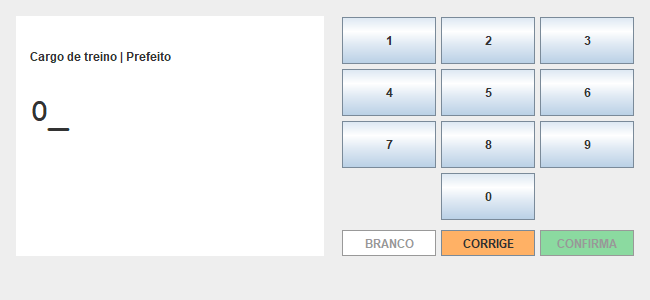
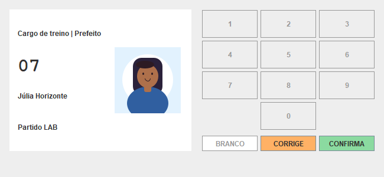
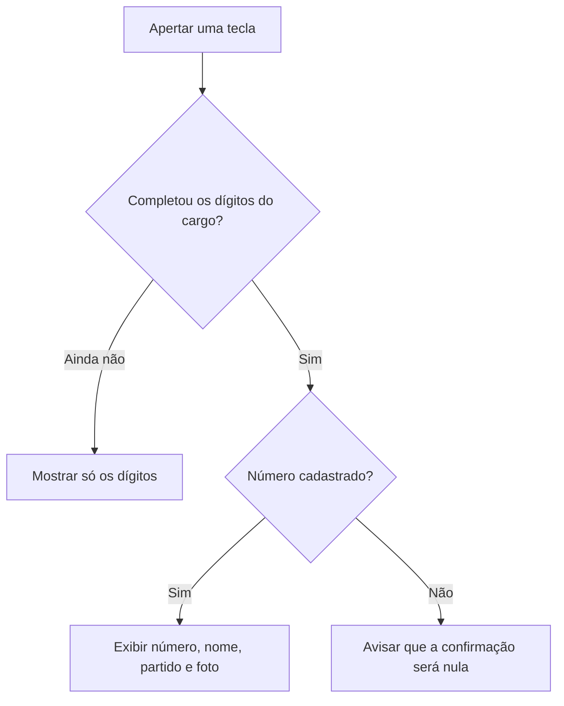

# 2. Construindo o teclado e o visor com Swing

[Voltar ao roteiro](../README.md) · [Aula anterior](01-maven.md) · [Próxima aula: exceções](03-excecoes.md)

Vamos começar com um cargo de treino e dois candidatos inventados. A ideia é vocês conseguirem ver o efeito de cada botão primeiro. Depois fica bem mais fácil colocar isso na tela que o grupo já começou.

## Comecem com um único botão

Se vocês ainda estão com um projeto Java simples, abram [TeclaSwing.java](../exemplos/primeiro-botao/TeclaSwing.java). Dá para copiar essa classe para um projeto Java comum e rodar o `main` no IntelliJ, ou testar diretamente pelo terminal com JDK 21, na pasta deste repositório.

```bash
java exemplos/primeiro-botao/TeclaSwing.java
```

A janela abre com um `_`. Cliquem em `7` e vejam o texto mudar. O botão tem um texto próprio e o visor tem outro. O método `addActionListener` recebe o que deve acontecer no clique. No código, `evento -> { ... }` é uma lambda. A parte dentro das chaves é executada quando o evento do botão acontece. Já `SwingUtilities.invokeLater` inicia a montagem da tela na thread do Swing.

## Rodem a urna

Na pasta com `pom.xml`, executem `mvn compile exec:java` ou rodem o `main` em [UrnaSwing.java](../src/main/java/br/edu/urna/swing/UrnaSwing.java). Nenhuma conta Firebase é necessária nesta aula.

| Façam isto | Observem isto |
| --- | --- |
| Apertem `0` | Aparece `0_`. Os dados e a foto estão limpos. |
| Apertem `7` | Aparecem `07`, Júlia Horizonte, partido LAB e a foto. |
| Apertem `CORRIGE` | O visor volta para `__` e a foto desaparece. |
| Digitem `99` | Aparece o aviso de número inexistente. Confirmar grava como nulo. |
| Apertem `BRANCO` e depois `CONFIRMA` | A tela primeiro avisa que o voto é em branco. Só depois registra. |
| Tentem confirmar com apenas um dígito | A confirmação fica desabilitada. |
| Votem em `12` | Aparecem os dados de Rafael e a outra imagem. |





## Desenhem o básico antes de preencher a urna

| Componente | Onde entra no nosso exemplo |
| --- | --- |
| `JFrame` | A janela que aparece na área de trabalho. |
| `JPanel` | Um agrupamento. Aqui temos um para o visor e outro para o teclado. |
| `JLabel` | Número, nome, partido, foto e mensagens. |
| `JButton` | Dígitos e ações. `addActionListener` executa o código do clique. |
| `BorderLayout` e `GridLayout` | O primeiro coloca o visor ao lado do teclado. O segundo organiza as teclas em grade. |

Quem estiver no IntelliJ pode escrever a tela em Java, como fiz no [PainelSwing.java](../src/main/java/br/edu/urna/swing/PainelSwing.java). Comecem com uma janela, um `JPanel` e um botão. Abaixo está a ideia do clique. O botão informa o número ao objeto `votacao` e manda a tela se redesenhar.

```java
var tecla = new JButton("7");
tecla.addActionListener(evento -> {
    votacao.digitar(7);
    atualizarVisor("");
});
```

Se o grupo já fez a tela no **NetBeans**, podem aproveitar o **GUI Builder**.

1. No pacote da tela, usem **New → JFrame Form**. Se não aparecer de primeira, usem **New → Other → Swing GUI Forms → JFrame Form**.
2. Na aba **Design**, arrastem um `JPanel` para o visor e outro para o teclado. Coloquem `JLabel` para os dados e `JButton` para os números e ações.
3. Em **Properties**, ajustem `text`. Em **Code**, deem nomes como `lblFoto` e `btnConfirma` para achar os componentes na hora de programar.
4. Cliquem duas vezes numa tecla ou usem **Events → Action → actionPerformed**. No método gerado para a tecla 7, coloquem a chamada `votacao.digitar(7);` e depois `atualizarVisor("");`. Façam o mesmo tipo de ligação para BRANCO, CORRIGE e CONFIRMA.
5. Guardem o código de negócio nos métodos que vocês criaram, fora do `initComponents()`. O NetBeans recria essa parte a partir do desenho. Incluam o `.form` no Git para o colega conseguir usar **Design**.


As imagens são do [tutorial oficial do NetBeans](https://netbeans.apache.org/tutorial/main/kb/docs/java/quickstart-gui/). O exemplo deles é um formulário de contato. Vejam o painel de desenho e a forma como os componentes são colocados.

## Em que momento a foto aparece?

Em [PainelVotacao.java](../src/main/java/br/edu/urna/dominio/PainelVotacao.java), o número começa como `""` e cada dígito é acrescentado como texto. `"07"` e `"7"` têm comprimentos diferentes, por isso guardar o número como `String` é importante. Quando a quantidade esperada é atingida, a urna procura o número na coleção de candidatos que já carregou. O clique em si só faz essa busca local. O retorno de `candidato()` é um `Optional<Candidato>`. Esse tipo nos permite perguntar `isPresent()` antes de obter o candidato, porque a busca pode vir vazia.



Em `atualizarVisor`, limpem o ícone e os textos anteriores antes de preencher o novo candidato. Esse detalhe faz diferença ao corrigir ou passar para o próximo cargo.

```java
lblFoto.setIcon(null);
lblFoto.setText("");
var selecionado = votacao.candidato();
if (selecionado.isPresent()) {
    var candidato = selecionado.get();
    var recurso = getClass().getResource(candidato.caminhoDaFoto());
    if (recurso == null) {
        lblFoto.setText("Sem foto");
    } else {
        lblFoto.setIcon(new ImageIcon(recurso));
    }
}
```

O método `caminhoDaFoto()` devolve algo como `/fotos/julia.png`. Confiram os [PNGs em src/main/resources/fotos](../src/main/resources/fotos). Se o grupo usar retratos maiores que os do treino, redimensione de forma proporcional para caber no visor antes de usar.

**Para praticar.** Incluam um terceiro candidato fictício em [RepositorioEmMemoria.java](../src/main/java/br/edu/urna/dados/RepositorioEmMemoria.java), com outro número de dois dígitos e um PNG próprio em `resources`. Testem também com o nome do arquivo errado. Quando entenderem por que um caso mostra a imagem e o outro mostra “Sem foto”, sigam para a aula de exceções.

Referências [Primeira tela Swing no NetBeans](https://netbeans.apache.org/tutorial/main/kb/docs/java/quickstart-gui/) · [Thread de eventos do Swing](https://docs.oracle.com/javase/tutorial/uiswing/concurrency/dispatch.html) · [Simulador do TSE](https://www.tse.jus.br/hotsites/simulador-de-votacao/).
