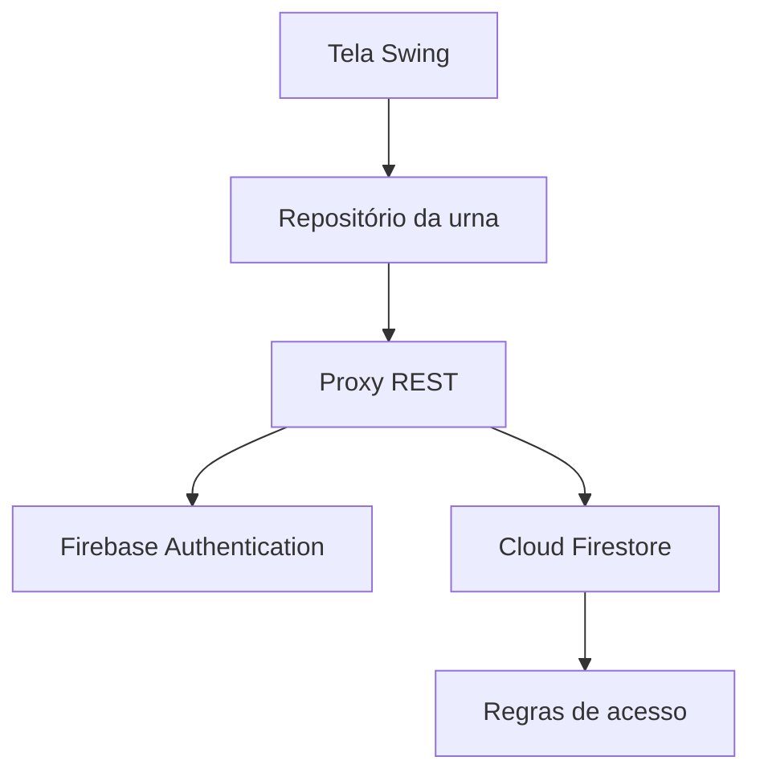

# 5A. Conectando Java comum ao Firestore

[Voltar ao roteiro](../README.md) · [Criar o banco](04-firestore.md) · [Versão com Maven](05-java-firebase.md) · [Próxima aula: JavaFX](06-javafx.md)

Nesta prática, vamos usar o `HttpClient` do JDK para conversar com o Firebase por HTTPS. A biblioteca **Gson** monta e lê as mensagens JSON. A mesma tela Swing que vocês já rodaram em memória vai receber um `FirestoreProxyRest`, que sabe consultar e gravar no banco.

Antes de conectar, abram a urna em memória pelo [roteiro do Java comum](00-java-comum.md). Depois [criem o Cloud Firestore Standard e os dois candidatos](04-firestore.md#cadastrar-os-dois-candidatos-de-treino). Deixem as imagens em `fotos`. A parte de conta de serviço da aula 4 atende à trilha Maven. Para esta trilha, usem os passos abaixo.

## 1. Criem o usuário de teste e anotem o UID

1. No [Console Firebase](https://console.firebase.google.com/), entrem no mesmo projeto em que cadastraram os candidatos.
2. Abram **Authentication → Começar**. Em **Sign-in method / Método de login**, habilitem **E-mail/senha** e salvem.
3. Em **Users / Usuários**, cliquem em **Add user / Adicionar usuário** e criem uma conta só para o laboratório com uma senha própria. Usem dados de teste. O login do exercício vai ser feito pelo programa.
4. Na lista de usuários, copiem o **UID do usuário**. É um identificador fornecido pelo Firebase, separado do e-mail.
5. Na engrenagem **Configurações do projeto → Geral**, anotem o **ID do projeto** e a **Chave da API da Web**. Se a chave não aparecer em **Geral**, cadastrem um app Web para consultar a propriedade `apiKey` no objeto de configuração. Criar esse app é só uma forma de consultar a configuração. O exemplo continua sendo uma aplicação Java de desktop.

A chave Web identifica o projeto perante o serviço de autenticação. A conta de teste recebe um token depois de informar o e-mail e a senha. Esse token permite que as regras do banco identifiquem o UID de quem fez a consulta. Usem a chave do mesmo projeto e mantenham as restrições do projeto. Nenhum arquivo JSON de conta de serviço é exigido para esta prática. [Login do Firebase por REST](https://firebase.google.com/docs/reference/rest/auth#section-sign-in-email-password) · [Chaves de API do Firebase](https://firebase.google.com/docs/projects/api-keys).

## 2. Publiquem as regras no banco de treino

1. No Firestore do **projeto de laboratório**, abram **Regras** e copiem o modelo [`java-comum/firestore.rules`](../java-comum/firestore.rules).
2. Na regra `request.auth.uid == 'COLE_AQUI_O_UID'`, troquem somente o texto entre aspas pelo UID copiado de **Authentication → Users**.
3. Cliquem em **Publicar**. Voltem à aba **Dados** e confiram que os documentos `07` e `12` estão em `candidatos_demo` e têm os campos `nome`, `partido` e `foto`, todos do tipo string.

O modelo foi feito para um banco separado de treino. Ele permite ao UID escolhido buscar candidatos e gravar votos de demonstração. O candidato nominal precisa existir. Um nulo leva um número de dois dígitos que não existe no cadastro. Para branco, `numero` fica vazio. Um documento de voto existente aceita a repetição do mesmo conteúdo. As demais coleções e alterações continuam bloqueadas por falta de permissão explícita. Grupos que forem armazenar duas escolhas por sessão devem modelar e testar regras para esse formato antes de gravá-lo. [Como funcionam as regras do Firestore](https://firebase.google.com/docs/firestore/security/rules-conditions).

O console pode mostrar os dados com as permissões administrativas de quem está logado. O aplicativo usa as permissões do usuário de teste. Por isso ver um documento no console não basta para saber se o programa pode lê-lo.

## 3. Configurem o arquivo local e coloquem o Gson no classpath

Copiem o [`.env.example` do Java comum](../java-comum/.env.example) para a raiz do projeto, com o nome `.env`.

```powershell
Copy-Item java-comum/.env.example .env
```

No macOS ou Linux, o equivalente é `cp java-comum/.env.example .env`. Se a pasta já tiver um `.env` de outra prática, guardem uma cópia em uma pasta protegida e usem os campos desta trilha para este teste. No projeto da equipe, o arquivo deve ficar na pasta configurada como **Working directory**.

```dotenv
FIREBASE_PROJECT_ID=urna-poo-grupo-03
FIREBASE_API_KEY=chave-web-do-projeto
FIREBASE_EMAIL=urna.laboratorio@example.com
FIREBASE_PASSWORD=senha-da-conta-de-teste
```

Cada configuração ocupa uma linha. Preencham os valores sem aspas. A chave Web fica junto das outras configurações de laboratório. A senha e o token de sessão são privados. Guardem o `.env` fora dos commits e confiram com `git check-ignore .env`. Se precisarem mostrar um erro, compartilhem a mensagem e retirem usuário, senha e token de qualquer print ou log. Se o Windows estiver ocultando extensões, confiram que o nome é `.env` e não `.env.txt`.

Baixem [gson-2.13.1.jar](https://repo.maven.apache.org/maven2/com/google/code/gson/gson/2.13.1/gson-2.13.1.jar) e coloquem em `java-comum/lib` no clone deste roteiro. Criem a pasta se ela ainda não existir. O nome Maven Central identifica o catálogo de onde o JAR é baixado. Nesta trilha vocês adicionam o arquivo manualmente, conforme [o passo a passo das IDEs](00-java-comum.md#como-acrescentar-um-jar-quando-precisarem). Se já estiverem no projeto Java comum do grupo, usem a pasta `lib` dele e ajustem o classpath.

## 4. Testem primeiro pelo console

Na raiz do repositório, compilem as duas entradas. Esses comandos procuram classes compartilhadas em `src/main/java` e classes da conexão REST em `java-comum/src`.

**Windows · PowerShell**

```powershell
$gson = "java-comum/lib/gson-2.13.1.jar"
$rest = "java-comum/src/br/edu/urna/rest"
javac --release 21 -encoding UTF-8 -cp $gson -sourcepath "src/main/java;java-comum/src" -d out "$rest/TestarFirestoreRest.java" "$rest/UrnaSwingComFirestoreRest.java"
java -cp "out;src/main/resources;$gson" br.edu.urna.rest.TestarFirestoreRest
```

**macOS ou Linux**

```bash
gson="java-comum/lib/gson-2.13.1.jar"
rest="java-comum/src/br/edu/urna/rest"
javac --release 21 -encoding UTF-8 -cp "$gson" -sourcepath "src/main/java:java-comum/src" -d out "$rest/TestarFirestoreRest.java" "$rest/UrnaSwingComFirestoreRest.java"
java -cp "out:src/main/resources:$gson" br.edu.urna.rest.TestarFirestoreRest
```

Pela IDE, copiem o pacote `rest`, façam o [preparo da estrutura e do JAR](00-java-comum.md#4-levem-os-exemplos-para-o-projeto-do-grupo) e executem [`TestarFirestoreRest.java`](../java-comum/src/br/edu/urna/rest/TestarFirestoreRest.java). Primeiro confiram o terminal.

```text
07 | Júlia Horizonte | LAB
12 | Rafael das Nuvens | TRILHA
Duas gravações com o mesmo ID. Confiram o documento em votos_demo: ...
```

Em **Firestore Database → Dados → votos_demo**, procurem o ID exibido. Devem encontrar **um documento** com `tipo = NOMINAL` e `numero = "07"`. A execução repete a escrita de propósito. Uma nova execução vai criar outro ID.

## 5. Abram a urna ligada ao banco

**PowerShell**, no mesmo terminal usado para compilar:

```powershell
java -cp "out;src/main/resources;$gson" br.edu.urna.rest.UrnaSwingComFirestoreRest
```

**macOS ou Linux:**

```bash
java -cp "out:src/main/resources:$gson" br.edu.urna.rest.UrnaSwingComFirestoreRest
```

Na IDE, rodem [`UrnaSwingComFirestoreRest.java`](../java-comum/src/br/edu/urna/rest/UrnaSwingComFirestoreRest.java). Digitem `07` antes de confirmar e vejam que a foto aparece do mesmo jeito que no teste em memória. Depois façam um nominal, um branco e um nulo. Conferir os três tipos no console ajuda a separar um problema da tela de um problema da gravação.

## O caminho do clique até a gravação



1. [`ConfiguracaoFirebaseRest`](../java-comum/src/br/edu/urna/rest/ConfiguracaoFirebaseRest.java) abre o `.env` e valida as configurações esperadas. Ler o arquivo é tarefa dessa classe.
2. [`FirestoreProxyRest`](../java-comum/src/br/edu/urna/rest/FirestoreProxyRest.java) faz um `POST` ao Firebase Authentication com e-mail e senha. Guarda o token em memória até perto de expirar. Essa classe reaproveita um `HttpClient`.
3. Em `listarCandidatos()`, o proxy faz `GET` em `candidatos_demo` e envia o token no cabeçalho `Authorization`. Cada documento se transforma em um objeto `Candidato`. O Swing carrega esses dados ao abrir a urna. A busca a cada botão acontece em memória.
4. Em `salvar(voto)`, o proxy faz `PATCH` em `votos_demo/{id}`. O JSON do Firestore marca o tipo de cada campo. Um nominal para `07` fica assim.

```json
{
  "fields": {
    "tipo": { "stringValue": "NOMINAL" },
    "numero": { "stringValue": "07" }
  }
}
```

5. O `SwingWorker` espera a resposta fora da thread da janela. Se a rede falhar, o visor fica com a escolha pendente. Para tentar de novo, usem o mesmo ID. Essa é a diferença entre reenviar uma operação e registrar um novo voto.

| Erro que aparece | O que conferir primeiro |
| --- | --- |
| `package com.google.gson does not exist` | O JAR está no caminho indicado e no classpath de compilação? |
| `NoClassDefFoundError: com/google/gson/…` | A mesma biblioteca precisa estar no classpath de execução. |
| `NoSuchFileException: .env` | Confiram o nome e a pasta **Working directory**. |
| `Firebase Authentication respondeu com HTTP 400` | Conferir chave Web, habilitação de E-mail/senha, e-mail e senha de teste. |
| `A sessão do Firebase expirou` | Abram a urna de novo se o erro ocorrer na inicialização. Se ocorreu ao gravar, apertem CONFIRMA de novo para renovar a sessão e repetir o mesmo voto. |
| `Acesso negado` ou HTTP 403 do Firestore | Conferir o UID real em **Authentication → Users**, as regras publicadas e a correspondência de projeto. |
| Conectou e não encontrou candidatos | Conferir o nome da coleção, o ID do projeto e o banco `(default)`. |
| O nome aparece e a foto não | Conferir o nome no banco e a pasta `fotos` no classpath. |

**Para praticar.** Confirmem um voto, localizem seu documento e confiram os tipos na coluna de campos. Depois simulem falta de rede com o app aberto e repitam CONFIRMA depois de reconectar. Confiram que a tela só avança quando recebe sucesso e que a repetição usa um único documento.

Para a apuração do trabalho, comecem pelo [modelo de eleição e pelos testes do relatório](07-trabalho.md). Neste laboratório, a conferência de votos é feita no console. Quando o projeto do grupo passar a ler os votos para mostrar a apuração, deem acesso de leitura somente à identidade responsável por essa função, nos caminhos da eleição que ela administra.

Referências [REST do Firestore em português](https://firebase.google.com/docs/firestore/use-rest-api?hl=pt-br) · [Listar documentos](https://docs.cloud.google.com/firestore/docs/reference/rest/v1/projects.databases.documents/list) · [Gravar um documento com PATCH](https://docs.cloud.google.com/firestore/docs/reference/rest/v1/projects.databases.documents/patch).
