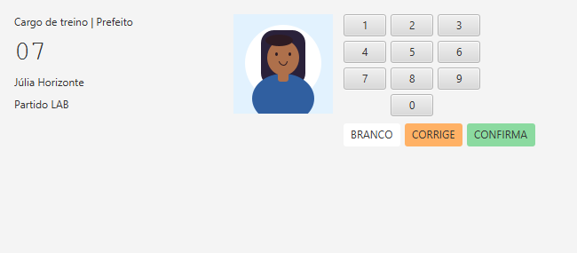

# 6. Aula extra · a mesma tela com JavaFX

[Voltar ao roteiro](../README.md) · [Firestore em Java comum](05-firestore-sem-maven.md) · [Firestore com Maven](05-java-firebase.md) · [Próxima aula: checklist do trabalho](07-trabalho.md)

JavaFX é outra forma de montar uma interface desktop em Java. Os enunciados da manhã e da noite pedem Swing na entrega. A prática desta aula serve para vocês experimentarem outra biblioteca e enxergarem o que dá para reaproveitar da lógica do projeto.

## Quem está com Maven

Usem o JDK 21 e importem o mesmo `pom.xml`. O Maven baixa `javafx-controls`. O `javafx-maven-plugin` indica qual classe abrir e prepara a execução. Se forem criar um projeto separado, copiem a dependência e o bloco do plugin com as versões do [POM deste repositório](../pom.xml). Ajustem `mainClass` para a classe de vocês.

```bash
mvn clean javafx:run
```

No IntelliJ, abram **View → Tool Windows → Maven** e procurem **Plugins → javafx → javafx:run**. Se a execução pelo triângulo verde disser `JavaFX runtime components are missing`, usem o objetivo Maven acima.

## Quem está com Java comum

### Baixem o SDK e confiram as pastas

Na [página oficial de download](https://gluonhq.com/products/javafx/), escolham o **JavaFX SDK 22**, a mesma versão do exemplo Maven. Selecionem o sistema e a arquitetura corretos: Windows x64, macOS Intel ou Apple Silicon, ou Linux de acordo com a máquina. Descompactem em uma pasta local. Confiram que o caminho termina em `lib` e que lá estão os JARs do JavaFX. Baixem o pacote **SDK**.

### Testem no terminal

Abram o terminal na raiz do repositório. Ajustem a primeira linha para a pasta `lib` de vocês.

**Windows · PowerShell**

```powershell
$fx = "C:/ferramentas/javafx-sdk-22/lib"
javac --release 21 -encoding UTF-8 --module-path $fx --add-modules javafx.controls -d out -sourcepath src/main/java src/main/java/br/edu/urna/javafx/UrnaFx.java
java --module-path $fx --add-modules javafx.controls -cp "out;src/main/resources" br.edu.urna.javafx.UrnaFx
```

**macOS ou Linux**

```bash
fx="/caminho/para/javafx-sdk-22/lib"
javac --release 21 -encoding UTF-8 --module-path "$fx" --add-modules javafx.controls -d out -sourcepath src/main/java src/main/java/br/edu/urna/javafx/UrnaFx.java
java --module-path "$fx" --add-modules javafx.controls -cp "out:src/main/resources" br.edu.urna.javafx.UrnaFx
```

O `--module-path` indica onde o Java encontra os módulos do JavaFX. `--add-modules javafx.controls` habilita os controles e suas dependências. O `-cp` reúne as classes da urna e os recursos. O projeto de treino não tem `module-info.java` nem usa FXML.

### Rodem o mesmo exemplo pela IDE

1. No projeto comum, aproveitem os pacotes `dominio` e as três classes de `dados` da [aula de preparo](00-java-comum.md). Adicionem [`UrnaFx.java`](../src/main/java/br/edu/urna/javafx/UrnaFx.java) no pacote `br.edu.urna.javafx`.
2. No **IntelliJ**, abram **File → Project Structure → Libraries → + → Java** e selecionem `lib` do SDK do JavaFX. Vinculem a biblioteca ao módulo da aplicação e confirmem que aparece nas dependências.
3. Criem uma configuração do tipo **Application** em **Run → Edit Configurations**. Indiquem `br.edu.urna.javafx.UrnaFx` como **Main class**. Em **Modify options → Add VM options**, usem a linha abaixo com o caminho correto.
4. No **NetBeans com Ant**, adicionem os JARs da pasta `lib` em **Project Properties → Libraries** para a compilação. Em **Project Properties → Run**, selecionem a classe principal e preencham **VM Options** com a mesma linha. O layout das opções pode variar conforme a versão da IDE.

```text
--module-path "C:/ferramentas/javafx-sdk-22/lib" --add-modules javafx.controls
```

As opções acima são da JVM. O campo **Program arguments** é repassado ao `main` e não serve para configurar o JavaFX. Se a IDE continuar usando outra configuração ao rodar um arquivo isolado, rodem a configuração do projeto que acabaram de criar.

**Resultado esperado.** A janela abre com o cargo e o teclado. Primeiro apertem `0`. Depois apertem `7` e confiram nome, partido e imagem. Usem **CORRIGE** para reiniciar a digitação.

## Comparar os componentes

| Swing | JavaFX | Onde usamos |
| --- | --- | --- |
| `JFrame` | `Stage` | A janela. |
| Painel principal | `Scene` com um nó raiz | Conteúdo que entra na janela. |
| `JPanel` com `GridLayout` | `GridPane` | Teclado numérico. |
| `JPanel` com distribuição em linha/coluna | `HBox` / `VBox` | Separar visor e teclado, ou empilhar os dados. |
| `JLabel` com `ImageIcon` | `ImageView` | Exibir o retrato. |
| `addActionListener` | `setOnAction` | Executar o código quando alguém clica. |

Em [UrnaFx.java](../src/main/java/br/edu/urna/javafx/UrnaFx.java), comecem pelo `start(Stage janela)`. Ele cria o teclado, os componentes do visor, encaixa o layout em uma `Scene` e chama `janela.show()`. Para entender o lugar de cada tecla, observem que `GridPane.add` recebe **componente, coluna, linha**, nesta ordem. Os índices começam em zero.

```java
var tecla = new Button("7");
tecla.setOnAction(evento -> {
    votacao.digitar(7);
    atualizarVisor("");
});
teclado.add(tecla, 0, 2);
```

O método `atualizarVisor` começa com `foto.setImage(null)`. Se a digitação estiver completa e o número existir, ele abre o PNG de `resources` e faz `foto.setImage(new Image(recurso.toExternalForm()))`. O objeto `PainelVotacao` continua o mesmo da aula Swing. Digitem `07`, usem `CORRIGE` e depois digitem `99` para comparar.



## Se quiserem praticar um pouco mais

Troquem a posição do visor com a do teclado no `HBox`. Depois, ajustem a grade ou experimentem um estilo CSS básico. Vejam que vocês conseguem mudar a aparência sem alterar a regra de quando o candidato aparece.

A urna JavaFX desta aula grava em memória. Se quiserem adaptar o exercício para Firestore por conta própria, carreguem a lista de candidatos antes de mostrar a tela e usem `Task` em uma thread de trabalho para salvar. Atualizem os componentes em `setOnSucceeded` e `setOnFailed`. Mantenham CONFIRMA desabilitado enquanto salva e preservem o ID da tentativa quando não houver resposta. A versão Swing da aula anterior já demonstra esse fluxo com `SwingWorker`.

| Se aparecer | Confiram |
| --- | --- |
| `package javafx... does not exist` | Com Maven, confiram o POM. No projeto comum, confiram os JARs do SDK na biblioteca de compilação. |
| `JavaFX runtime components are missing` | Com Maven, rodem `mvn javafx:run`. No projeto comum, confiram as opções da JVM e a pasta `lib` do SDK. |
| A janela abre, mas não aparece a foto | O nome do PNG e o caminho em `resources` coincidem? |
| A janela trava depois de ligar o banco | Uma chamada de rede pode ter ficado dentro do evento do botão. |

Referências [OpenJFX com Maven e SDK](https://openjfx.io/openjfx-docs/) · [Download oficial](https://gluonhq.com/products/javafx/) · [Task na API JavaFX 22](https://openjfx.io/javadoc/22/javafx.graphics/javafx/concurrent/Task.html).
