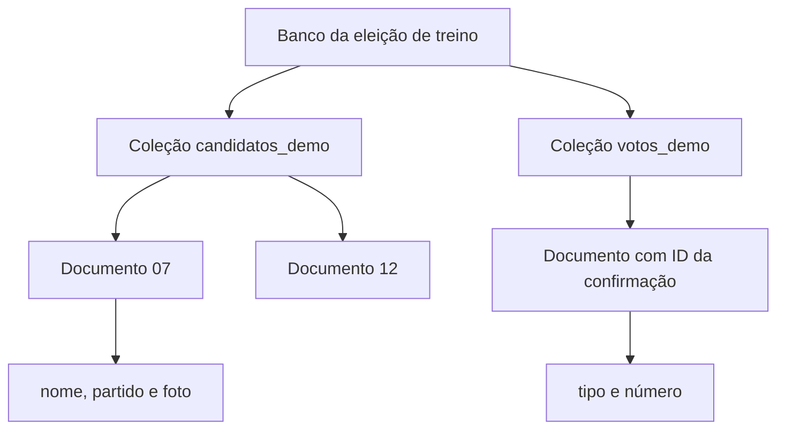

# 4. Criando o banco no Firebase

[Voltar ao roteiro](https://github.com/NirtonAfonso/Tutorial-Firebase/wiki) · [Aula anterior](https://github.com/NirtonAfonso/Tutorial-Firebase/wiki/Tratamento-de-erros) · [Conectar com Java comum](https://github.com/NirtonAfonso/Tutorial-Firebase/wiki/Firestore-sem-Maven) · [Conectar com Maven](https://github.com/NirtonAfonso/Tutorial-Firebase/wiki/Firestore-com-Maven)

**Arquivos desta prática** · [Exemplo Java comum](https://github.com/NirtonAfonso/Tutorial-Firebase/tree/main/exemplos/java-comum/04-persistencia) · [Exemplo Maven](https://github.com/NirtonAfonso/Tutorial-Firebase/tree/main/exemplos/maven/04-persistencia).

## O que precisa continuar existindo depois que a urna fecha?

Se vocês guardarem o voto em uma variável, ele estará na memória do programa. Fechem o programa e iniciem outro processo: a nova execução começa com novas variáveis. **Persistir** é escrever a informação em um meio onde outra execução possa recuperá-la. Antes de criar qualquer conta, vamos observar essa diferença usando um arquivo local.

Na pasta **04-persistencia** da trilha que escolheram, façam duas execuções, na ordem abaixo, usando o mesmo diretório.

| Trilha | Primeira execução | Segunda execução |
| --- | --- | --- |
| Java comum | `java src/CadastroLocal.java gravar` | `java src/CadastroLocal.java` |
| Maven | `mvn compile exec:java "-Dexec.args=gravar"` | `mvn compile exec:java` |

Na primeira, o programa associa a chave `07` ao nome Júlia Horizonte em um mapa e grava o nome em `cadastro-de-treino.txt`. Na segunda, o mapa começa vazio, mas o arquivo ainda contém o nome. Tentem prever as duas linhas do console antes de executar. Esse arquivo mostra a ideia de **durabilidade**. Agora imaginem a dificuldade de combinar arquivos de várias máquinas, encontrar um candidato pelo número e controlar quem pode gravar. Um sistema de gerenciamento de banco de dados oferece operações e controles para lidar com essas tarefas.

### Como organizar os dados da urna

Um **banco de dados** armazena informações organizadas para consulta e alteração. Num banco relacional, costumamos modelar tabelas, linhas, colunas e relações entre chaves. O Firestore organiza os dados em **documentos** agrupados em **coleções**. Cada documento tem um **ID**, único dentro da coleção, e **campos** com nome e tipo. O caminho `candidatos_demo/07` identifica um documento. O campo `nome` dentro dele responde a outra pergunta: “Como mostrar esse candidato no visor?”. O ID `07` e o número inteiro `7` são representações diferentes. Para dígitos digitados em uma urna, a string preserva a escolha.



| Operação sobre dados | Exemplo da aula |
| --- | --- |
| Criar | Cadastrar Júlia no documento `07`. |
| Ler | Abrir o documento ou listar os candidatos para montar a tela. |
| Atualizar | Corrigir o campo `partido` do mesmo documento. |
| Excluir | Remover um cadastro fictício criado só para praticar. |

Essas quatro operações costumam aparecer com a sigla **CRUD**. Uma **consulta** seleciona dados por algum critério, por exemplo os votos de determinada eleição e cargo. Um **índice** é uma estrutura auxiliar para localizar resultados com eficiência. Já uma gravação **atômica** acontece por inteiro ou não se aplica. Se houver dois documentos, um para cada cargo de uma sessão, um lote atômico evita confirmar apenas metade. Voltaremos a isso no roteiro de entrega.

**Confiram o modelo antes dos cliques.** Dois candidatos de cargos diferentes podem compartilhar um número? Sim. No treino há apenas um cargo. No trabalho, o caminho ou a chave deve identificar também o cargo e a eleição.

Firebase é a plataforma. Para este roteiro, dentro dela vamos usar o **Cloud Firestore**, o banco NoSQL que aparece no projeto de extensão. Na AV3 o enunciado também traz um link do Realtime Database. Os dois serviços têm formatos e APIs diferentes. Para os exemplos abaixo, sigam pelo **Firestore**.

Até cadastrar os candidatos, os passos abaixo valem para os dois caminhos. Depois disso, para **Java comum**, configurem [Authentication, regras e `.env` REST](https://github.com/NirtonAfonso/Tutorial-Firebase/wiki/Firestore-sem-Maven). Para **Maven**, sigam a configuração de conta de serviço mais abaixo.

Pensem em uma **coleção** como um conjunto de documentos. Cada documento tem um ID e vários campos. Vamos guardar `07` como ID do candidato para preservar o zero inicial. A foto fica nos recursos do projeto. No banco guardamos apenas o nome do PNG.

## Criar o projeto e o banco

1. Entrem no [Console Firebase](https://console.firebase.google.com/) com sua conta Google e escolham **Criar um projeto**. Usem um nome de laboratório, como `urna-poo-grupo-03`. O **ID do projeto** aparece na configuração e pode ser diferente do nome exibido. Anotem o ID.
2. Avancem pelas opções. Analytics e os demais produtos são dispensáveis para este exercício. Não é necessário cadastrar aplicativo Android, iOS ou Web.
3. Na barra lateral, abram **Firestore Database**. Dependendo do idioma ou da versão do console, a opção aparece em **Criar/Build** ou **Databases & Storage**. Cliquem em **Criar banco de dados**.
4. Selecionem **Standard**, o banco padrão `(default)` e uma localização disponível para o grupo. A localização é uma escolha permanente para esse banco. Confiram antes de criar.
5. Escolham **modo de produção**. O cliente sem autorização fica bloqueado. Na trilha Maven, o Java usa uma conta de serviço autorizada no IAM. Na trilha Java comum, vocês publicam as regras específicas para o usuário de teste na aula de conexão REST.

## Cadastrar os dois candidatos de treino

Na aba **Dados**, cliquem em **Iniciar coleção** e preencham o ID com `candidatos_demo`. No primeiro documento, digitem `07` no campo de ID, sem usar ID automático. Cada um dos três campos abaixo tem tipo **string**. Salvem e usem **Adicionar documento** para o segundo candidato.

| ID do documento | `nome` | `partido` | `foto` |
| --- | --- | --- | --- |
| `07` | Júlia Horizonte | LAB | `julia.png` |
| `12` | Rafael das Nuvens | TRILHA | `rafael.png` |

Os nomes dos campos são minúsculos e sem acento. Guardem apenas o nome do PNG no campo `foto`. Na aula 5, a primeira gravação cria a coleção `votos_demo` automaticamente.


Imagem do [codelab oficial do Firebase](https://firebase.google.com/codelabs/firestore-web). Nesse print os dados são de um restaurante. Na urna, a coluna da esquerda deve mostrar `candidatos_demo` e a do meio deve mostrar `07` e `12`.

## Escolher a conexão depois de cadastrar os candidatos

Se o grupo está em **Java comum**, o cadastro está pronto para a próxima etapa. [Criem a conta de teste e conectem por REST](https://github.com/NirtonAfonso/Tutorial-Firebase/wiki/Firestore-sem-Maven).

### Maven · criar uma credencial para o laboratório

Usem um projeto separado, dados fictícios e uma estação de desenvolvimento controlada pelo grupo. O Admin SDK autentica como uma conta de serviço e usa permissões do **IAM**. As **Security Rules** do Firestore valem para os clientes a que elas se aplicam, mas o Admin SDK não é filtrado por essas regras. Por isso a chave fica na máquina que executa o laboratório. Para distribuir a urna a usuários em outros computadores, mantenham a credencial em um backend controlado e façam a tela chamar esse backend.

1. No [Console do Google Cloud](https://console.cloud.google.com/iam-admin/serviceaccounts), selecionem o **mesmo projeto**. Abram **IAM e administrador → Contas de serviço → Criar conta de serviço**.
2. Deem um nome como `urna-laboratorio`. Concedam à conta de serviço o papel **Cloud Datastore User** (`roles/datastore.user`) nesse projeto, que permite ler e escrever os dados necessários ao exemplo. Se o assistente pular o papel, abram **IAM → Conceder acesso** e preencham o e-mail da própria conta de serviço. Usem esse papel restrito ao projeto de testes.
3. Na conta criada, abram **Chaves → Adicionar chave → Criar nova chave → JSON**. Se uma política institucional bloquear a criação de chaves, usem um ambiente autorizado para a prática e mantenham o modo em memória enquanto isso.
4. Guardem o JSON fora do repositório, com acesso apenas de quem administra aquele ambiente. Na tela **Contas de serviço** do Firebase também é possível encontrar as instruções oficiais do Admin SDK. Neste exercício a conta dedicada facilita limitar a permissão.

### Maven · configurar o arquivo `.env`

Na pasta `exemplos/maven/05-firestore`, ao lado do `pom.xml`, façam uma cópia do [`.env.example`](https://github.com/NirtonAfonso/Tutorial-Firebase/blob/main/exemplos/maven/05-firestore/.env.example) chamada `.env`.

```powershell
Copy-Item .env.example .env
```

No macOS ou Linux, usem `cp .env.example .env`. No Windows, confirmem que o nome ficou `.env` e que o editor não acrescentou `.txt`.

```dotenv
FIREBASE_PROJECT_ID=urna-poo-grupo-03
FIREBASE_CREDENTIALS=C:/laboratorio-urna/credenciais/conta-de-servico.json
```

Os valores acima são exemplos. Usem o ID real do projeto de laboratório e o caminho absoluto real, com barras `/` (inclusive no Windows). Deixem os valores sem aspas. O leitor de `.env` do exemplo usa `Properties` para linhas `CHAVE=valor`. Ele procura `.env` na pasta de execução. A chave privada continua no JSON, fora do Git. No IntelliJ, confiram **Run → Edit Configurations → Working directory** se o programa não achar o arquivo.

```bash
git check-ignore .env
git status --short
```

O primeiro comando deve mostrar `.env`. O segundo lista o que o Git detectou como alterado. Confiram a lista antes de enviar. Se uma chave já tiver ido para o Git, revoguem a chave no IAM, gerem outra se necessário e tratem o histórico com quem administra o repositório.

**Antes de seguir.** Verifiquem se `candidatos_demo` tem os dois documentos de treino, se o ID do projeto coincide com o da conta de serviço e se o JSON está fora da pasta do Git.

Referências [Cloud Firestore Standard](https://firebase.google.com/docs/firestore/quickstart?hl=pt-br) · [Admin SDK](https://firebase.google.com/docs/admin/setup?hl=pt-br) · [Permissões IAM do Firestore](https://firebase.google.com/docs/firestore/security/iam) · [Gerenciar chaves](https://cloud.google.com/iam/docs/keys-create-delete).
