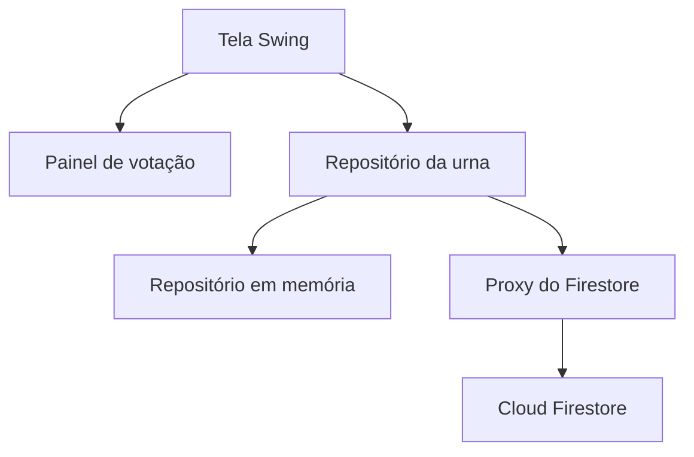

# 5B. Conectando o projeto Maven ao Firestore

[Voltar ao roteiro](https://github.com/NirtonAfonso/Tutorial-Firebase/wiki) · [Criar o banco](https://github.com/NirtonAfonso/Tutorial-Firebase/wiki/Banco-no-Firebase) · [Versão em Java comum](https://github.com/NirtonAfonso/Tutorial-Firebase/wiki/Firestore-sem-Maven) · [Próxima aula: JavaFX](https://github.com/NirtonAfonso/Tutorial-Firebase/wiki/JavaFX)

**Arquivos desta prática** · [Exemplo Maven](https://github.com/NirtonAfonso/Tutorial-Firebase/tree/main/exemplos/maven/05-firestore).

Abram o terminal em `exemplos/maven/05-firestore`. Essa será a pasta de execução do laboratório, inclusive ao procurar o arquivo `.env`.

## O que fica entre o clique e o banco?

Uma **interface Java** declara o que um objeto oferece. Abram `RepositorioUrna`: há uma operação para obter os candidatos e outra para salvar o voto. A tela recebe qualquer objeto que cumpra esse contrato. A implementação em memória guarda objetos Java. A implementação `FirestoreProxy` traduz o voto em campos do Firestore e aguarda o resultado. Experimentem procurar por `Firebase` em `PainelSwing.java`: a tela consegue confirmar justamente porque depende do contrato, mesmo sem conhecer o fornecedor.

Um **SDK** reúne classes e recursos para conversar com um serviço. O Admin SDK usa uma identidade de serviço autorizada no projeto Google Cloud. **IAM** é o controle que associa identidades a permissões. O Maven baixa o SDK e suas dependências. Ele não cria o banco nem concede acesso. O `.env` indica qual projeto usar e onde está o arquivo da identidade. Só usem a chave administrativa em uma máquina de desenvolvimento controlada. Em uma aplicação que será instalada nos computadores dos usuários, essa operação pertence a um servidor administrado pela equipe.

Sigam uma gravação no fonte. `collection("votos_demo")` seleciona a coleção. `document(id)` seleciona o caminho daquele voto. `set(dados)` solicita a escrita. O objeto devolvido representa um **resultado futuro**: a chamada foi iniciada, mas o sucesso ainda precisa ser confirmado. Enquanto o proxy aguarda, o `SwingWorker` deixa a janela livre. O proxy traduz falhas externas para a exceção que a tela conhece e preserva a causa para diagnóstico.


Identifiquem a coleção e um documento no exemplo do Firebase. Na nossa gravação, usando o mesmo ID e o mesmo conteúdo, repetir a chamada deixa um único documento. Se a aplicação criasse um ID novo a cada tentativa, a segunda chamada poderia registrar outro voto. Chamamos a primeira propriedade de **idempotência** da operação de repetição. [Modelo ilustrado no codelab oficial](https://firebase.google.com/codelabs/firestore-web).

Primeiro façam o console ler e gravar. Quando essa etapa funcionar, liguem a tela. Se vocês tentarem as duas coisas de uma vez e a foto não aparecer, vão ter mais lugares para investigar.

Nesta trilha, o Maven baixa o Admin SDK que está declarado no POM. Antes de rodar o teste, façam no [roteiro de criação do banco](https://github.com/NirtonAfonso/Tutorial-Firebase/wiki/Banco-no-Firebase) o cadastro dos dois candidatos, a configuração da conta de serviço e o `.env` da trilha Maven.

## Quem faz cada parte

| Classe | Tarefa |
| --- | --- |
| [FirebaseConexao](https://github.com/NirtonAfonso/Tutorial-Firebase/blob/main/exemplos/maven/05-firestore/src/main/java/br/edu/urna/dados/FirebaseConexao.java) | Lê o `.env`, abre a chave, inicia o Firebase uma vez e encerra a conexão quando a aplicação fecha. |
| [RepositorioUrna](https://github.com/NirtonAfonso/Tutorial-Firebase/blob/main/exemplos/maven/05-firestore/src/main/java/br/edu/urna/dados/RepositorioUrna.java) | Interface com as operações de que a urna precisa: listar candidatos e salvar voto. |
| [FirestoreProxy](https://github.com/NirtonAfonso/Tutorial-Firebase/blob/main/exemplos/maven/05-firestore/src/main/java/br/edu/urna/dados/FirestoreProxy.java) | Implementa a interface. É a classe intermediária entre a urna e o SDK. Traduz documentos para os objetos Java e converte falhas de persistência. |
| [RepositorioEmMemoria](https://github.com/NirtonAfonso/Tutorial-Firebase/blob/main/exemplos/maven/05-firestore/src/main/java/br/edu/urna/dados/RepositorioEmMemoria.java) | Implementa a mesma interface. Serve para praticar a tela com dados locais. |
| [PainelVotacao](https://github.com/NirtonAfonso/Tutorial-Firebase/blob/main/exemplos/maven/05-firestore/src/main/java/br/edu/urna/dominio/PainelVotacao.java) | Guarda os dígitos, sabe se a seleção foi em branco e determina o tipo do voto. |
| [PainelSwing](https://github.com/NirtonAfonso/Tutorial-Firebase/blob/main/exemplos/maven/05-firestore/src/main/java/br/edu/urna/swing/PainelSwing.java) | Cuida dos botões, do visor e da mensagem que o usuário recebe. |



Reparem que conseguimos trocar a implementação de `RepositorioUrna` e reaproveitar a tela. Isso é polimorfismo no projeto. O nome `FirestoreProxy` indica a classe intermediária, que faz também o trabalho de repositório. O código da tela só precisa chamar `salvar(voto)`.

## 1. Rodar o teste de leitura e gravação

1. Confiram o `.env` e os dois candidatos criados na [aula anterior](https://github.com/NirtonAfonso/Tutorial-Firebase/wiki/Banco-no-Firebase).
2. No IntelliJ, abram [TestarFirestore.java](https://github.com/NirtonAfonso/Tutorial-Firebase/blob/main/exemplos/maven/05-firestore/src/main/java/br/edu/urna/laboratorio/TestarFirestore.java) e executem o `main`. Pelo terminal, na pasta do POM, usem o comando abaixo. As aspas em torno do argumento `-D...` ajudam no PowerShell.

```bash
mvn compile exec:java "-Dexec.mainClass=br.edu.urna.laboratorio.TestarFirestore"
```

3. O console deve mostrar `07 | Júlia Horizonte | LAB` e `12 | Rafael das Nuvens | TRILHA`, além de um identificador para o voto de teste.
4. Voltem ao Firebase, abram **Firestore Database → Dados → votos_demo** e localizem esse ID. O programa repete a escrita com o mesmo ID para mostrar que uma tentativa repetida mantém um documento. Cada execução nova do programa gera um ID novo.

O objeto `Voto` guarda tipo e número. `Voto` e `Candidato` foram escritos como `record`, uma forma curta de declarar classes de dados com campos que não mudam depois da criação. Por isso usamos `candidato.numero()` no lugar de um `getNumero()` que teríamos de escrever numa classe comum. Em alguns trechos aparece `var`. O Java deduz o tipo pela expressão à direita, por exemplo, `var repositorio = new FirestoreProxy(...)`. No banco, o voto em branco é `tipo = BRANCO` e `numero = ""`. No nulo de treino, o campo `numero` contém o número digitado e `tipo = NULO`. O exemplo está restrito a um cargo fictício. Nenhum campo guarda identificação de eleitor.

## 2. Rodar a tela ligada ao banco

```bash
mvn compile exec:java "-Dexec.mainClass=br.edu.urna.laboratorio.UrnaSwingComFirestore"
```

Também dá para rodar o `main` em [UrnaSwingComFirestore.java](https://github.com/NirtonAfonso/Tutorial-Firebase/blob/main/exemplos/maven/05-firestore/src/main/java/br/edu/urna/laboratorio/UrnaSwingComFirestore.java). Essa classe abre a conexão e passa o `FirestoreProxy` para a mesma tela da aula 2. Carreguem o cadastro no começo de cada sessão de treino. Se alterarem um candidato no console durante o teste, reabram a aplicação para recarregar a lista.

1. Votem em `07` e confiram `tipo=NOMINAL` no console do Firebase.
2. Façam uma votação em branco e confiram `tipo=BRANCO`.
3. Digitem `99` e confirmem. Confiram `tipo=NULO`.
4. Façam mais uma tentativa, interrompendo a conexão antes de apertar CONFIRMA. Depois do aviso, restabeleçam a conexão e apertem CONFIRMA novamente. O mesmo ID é reaproveitado. Façam esse exercício em um banco de teste do grupo.

## Cuidados que já ajudam no trabalho

- Criem a conexão uma vez. Usem a mesma instância para as operações da aplicação.
- Busquem candidatos antes do começo da votação e trabalhem com a lista em memória para mostrar a foto. Para verificar números, usem cargo e número como chave lógica. Dois cargos podem ter um mesmo número.
- Evitem o padrão “ler total, somar um e sobrescrever” quando houver duas urnas salvando ao mesmo tempo. Duas máquinas podem ler o mesmo total antigo. Comecem com um documento por confirmação e apurem por cargo. Para gravar os dois cargos como uma unidade, usem um documento por sessão com as duas escolhas ou um batch atômico com IDs fixos.
- Criem IDs de votação por eleição. Isso permite testar com uma sessão separada e iniciar uma nova zerada sem apagar a votação anterior.
- Mantenham o `.env` e a chave fora do commit. No README da equipe, descrevam as variáveis por meio do `.env.example` com valores fictícios.

| Se aparecer | Confiram |
| --- | --- |
| `NoSuchFileException: .env` | A raiz do projeto e o diretório de execução. |
| `NoSuchFileException` para o JSON | O caminho em `FIREBASE_CREDENTIALS`. Usem barras `/`. |
| `PERMISSION_DENIED` | O projeto e o papel da conta de serviço no IAM. Mantenham as regras de produção. |
| `NOT_FOUND` para o banco | Se o ID aponta para o projeto correto e se o banco `(default)` já foi criado. |
| Conectou e a lista veio vazia | O nome `candidatos_demo` e a aba Dados do projeto onde vocês cadastraram os documentos. |
| Falha ao montar um candidato | Os três campos precisam existir como strings. O ID tem dois dígitos e o nome da foto termina em `.png`. |
| O banco tem o documento e a tela não tem a foto | A foto precisa existir em `src/main/resources/fotos` com o mesmo nome salvo. |

**Antes de seguir.** Fechem a aplicação, reabram o console do Firebase e verifiquem se os votos continuam lá. Peçam a um colega para explicar de onde vêm os dados e por que o clique no teclado não depende da internet.

Referências [SDKs de servidor e Firestore](https://firebase.google.com/docs/firestore/quickstart-server) · [Gravar documentos](https://firebase.google.com/docs/firestore/manage-data/add-data) · [Transações e gravações em lote](https://firebase.google.com/docs/firestore/manage-data/transactions).
