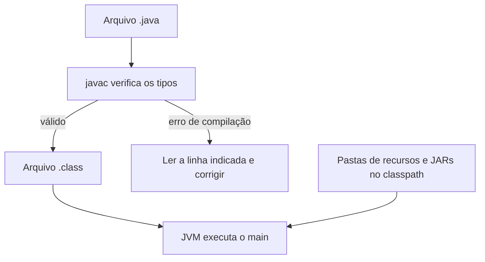
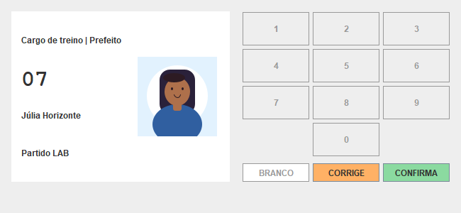

# 1A. Começando com um projeto Java comum

[Voltar ao roteiro](https://github.com/NirtonAfonso/Tutorial-Firebase/wiki) · [Próxima aula: Swing](https://github.com/NirtonAfonso/Tutorial-Firebase/wiki/Swing-e-fotos)

**Arquivos desta prática** · [Exemplo Java comum](https://github.com/NirtonAfonso/Tutorial-Firebase/tree/main/exemplos/java-comum/01-primeiro-botao). Para a segunda janela, abram também [Exemplo Java comum](https://github.com/NirtonAfonso/Tutorial-Firebase/tree/main/exemplos/java-comum/02-swing-e-fotos).

## Da classe escrita à janela aberta

Quando vocês criam uma classe na IDE, o arquivo `.java` guarda texto. O compilador do **JDK** lê esse texto, verifica tipos e gera arquivos `.class`. A **JVM**, a máquina virtual iniciada pelo comando `java`, executa essas instruções. A IDE reúne editor, compilação e execução em um botão. Dá para ver essas etapas separadamente no terminal.

Façam primeiro uma previsão. Se o programa compilar e a foto estiver fora da pasta de recursos, em que momento aparece o problema? O compilador verifica que o método de carregar a foto existe. Só ao abrir a tela o programa procura o arquivo. Por isso o diagnóstico depende de saber **em qual etapa** ocorreu a falha.



A **pasta de fontes** é o ponto a partir do qual o Java encontra os pacotes. O **classpath** reúne os lugares onde procurar classes e recursos. Um **JAR** é um arquivo que pode agrupar classes e recursos de uma biblioteca. Vocês vão precisar de um para interpretar as respostas do Firebase na aula de conexão. O primeiro botão usa somente o JDK.


No print do NetBeans, localizem a área de desenho. O que aparece nela depois de adicionar os componentes corresponde aos objetos que o nosso primeiro exemplo cria em Java. Quem usa IntelliJ pode acompanhar observando o código de `TeclaSwing`. [Imagem e tutorial do Apache NetBeans](https://netbeans.apache.org/tutorial/main/kb/docs/java/quickstart-gui/).

Se vocês já têm um projeto Java aberto no IntelliJ ou no NetBeans, podem aproveitar o que fizeram. Nesta trilha, o JDK compila as classes. Swing já vem no JDK. Para acessar o Firestore, vamos acrescentar um JAR para ler e montar JSON. Quem fizer a aula complementar de JavaFX vai baixar também o SDK do JavaFX.

## 1. Confiram o JDK

No terminal, rodem os dois comandos.

```text
java -version
javac -version
```

Os dois devem apontar para o **JDK 21**. O `javac` é o compilador. Se apenas `java` funcionar, confiram a instalação e o `PATH`. No IntelliJ, confiram também **File → Project Structure → Project → SDK**. No NetBeans, vejam **Tools → Java Platforms** e a plataforma escolhida nas propriedades do projeto.

## 2. Abram uma janela pequena primeiro

Na raiz do repositório, executem o arquivo abaixo. O Java 21 consegue executar um arquivo-fonte diretamente.

```text
java exemplos/java-comum/01-primeiro-botao/src/TeclaSwing.java
```

A janela abre com `_`. Ao clicar em **7**, o visor mostra `7`. Se estiverem fazendo pela IDE, também podem criar a classe [TeclaSwing.java](https://github.com/NirtonAfonso/Tutorial-Firebase/blob/main/exemplos/java-comum/01-primeiro-botao/src/TeclaSwing.java) em um projeto comum e rodar o `main`.

**No IntelliJ, para criar um projeto do zero.** Vão em **File → New → Project → Java**, escolham **IntelliJ** em **Build system** e selecionem o JDK 21. Criem em uma pasta separada do repositório de exemplo. Assim o IntelliJ abre o projeto como Java comum.

**No NetBeans, para criar um projeto do zero.** Vão em **File → New Project → Java with Ant → Java Application**. Escolham o JDK 21. Se forem desenhar a janela, adicionem um **JFrame Form** no pacote da tela e usem a aba **Design**. O NetBeans guarda o desenho no `.form`. Mantenham esse arquivo junto da classe `.java`.

## 3. Executem a urna de treino sem banco

Na raiz do repositório, entrem em `exemplos/java-comum/02-swing-e-fotos` com `cd exemplos/java-comum/02-swing-e-fotos`. Executem os dois comandos seguintes dentro dessa pasta.

**Windows · PowerShell**

```powershell
javac --release 21 -encoding UTF-8 -d out -sourcepath src src/br/edu/urna/swing/UrnaSwing.java
java -cp "out;recursos" br.edu.urna.swing.UrnaSwing
```

**macOS ou Linux**

```bash
javac --release 21 -encoding UTF-8 -d out -sourcepath src src/br/edu/urna/swing/UrnaSwing.java
java -cp "out:recursos" br.edu.urna.swing.UrnaSwing
```

O primeiro comando compila a entrada `UrnaSwing.java` e as classes que ela usa, procurando os fontes em `src`. A opção `-d out` define o destino dos arquivos `.class`. Já `-cp` indica onde o Java procura classes e recursos ao executar. O separador é `;` no Windows e `:` no macOS e no Linux. As aspas mantêm o classpath inteiro no mesmo argumento.

Digitem `0` e reparem no visor `0_`, ainda sem foto. Depois digitem `7`. Devem aparecer **Júlia Horizonte**, o partido LAB e o retrato. Apertem **CORRIGE** e confiram que o visor limpa. Experimentem também **BRANCO** e o número `99`.



## Abrir uma pasta de exemplo na IDE

No IntelliJ, usem **File → Open** e selecionem uma pasta como `exemplos/java-comum/02-swing-e-fotos`. Selecionem o JDK 21. Se o triângulo de execução não aparecer, cliquem com o botão direito em `src` e usem **Mark Directory as → Sources Root**. Façam o mesmo em `recursos`, escolhendo **Resources Root**. Abram `br.edu.urna.swing.UrnaSwing` e executem o `main`. Para os exemplos de console que abrem um arquivo, o diretório de trabalho é a pasta do exemplo, no mesmo nível de `src`.

No NetBeans, os exemplos de Java comum vêm com os fontes. Para trabalhar com eles em um projeto Ant, criem um **Java Application** vazio para o assunto, desmarquem a criação da classe principal se o assistente oferecer essa opção e copiem o conteúdo de `src` do exemplo para **Source Packages**. Se o exemplo contiver `recursos/fotos`, copiem `fotos` para a raiz de `src` no projeto NetBeans. No de exceções, coloquem `candidato.txt` na pasta do projeto, ao lado de `src`. Usem **Run File** na classe indicada na aula. Se o programa roda pelo terminal e falha pela IDE, comparem o JDK, o diretório de trabalho e os caminhos de recursos.

## 4. Levem os exemplos para o projeto do grupo

Se forem rodar os exemplos na IDE ou aproveitar código na urna do grupo, usem esta ordem. Se já tiverem uma classe com a mesma responsabilidade, comparem com a do exemplo e adaptem os métodos aos poucos.

| Do repositório | O que copiar para o projeto Java comum |
| --- | --- |
| [dominio](https://github.com/NirtonAfonso/Tutorial-Firebase/tree/main/exemplos/java-comum/02-swing-e-fotos/src/br/edu/urna/dominio) | `Candidato`, `Voto` e `PainelVotacao`. Mantenham em `src/br/edu/urna/dominio` ou na pasta equivalente de fontes. |
| [dados](https://github.com/NirtonAfonso/Tutorial-Firebase/tree/main/exemplos/java-comum/02-swing-e-fotos/src/br/edu/urna/dados) | Comecem com `RepositorioUrna`, `RepositorioEmMemoria` e `PersistenciaException`. |
| [swing](https://github.com/NirtonAfonso/Tutorial-Firebase/tree/main/exemplos/java-comum/02-swing-e-fotos/src/br/edu/urna/swing) | `UrnaSwing` e `PainelSwing`. Rodem o `main` de `UrnaSwing`. |
| [fotos](https://github.com/NirtonAfonso/Tutorial-Firebase/tree/main/exemplos/java-comum/02-swing-e-fotos/recursos/fotos) | Copiem a pasta `fotos` inteira. Ela precisa ficar na raiz dos recursos que entram no classpath. |
| [rest](https://github.com/NirtonAfonso/Tutorial-Firebase/tree/main/exemplos/java-comum/05-firestore/src/br/edu/urna/rest) | Acrescentem este pacote quando chegarem ao Firestore pela API REST. |

A pasta de fontes começa antes do pacote. Por exemplo, o arquivo `src/br/edu/urna/swing/UrnaSwing.java` declara `package br.edu.urna.swing;`. Se o grupo usar outro pacote, ajustem também os `import` das classes que se comunicam.

Para os PNGs:

- **IntelliJ.** Criem uma pasta `recursos` ao lado de `src` e ponham as fotos em `recursos/fotos`. Cliquem com o botão direito em `recursos` e escolham **Mark Directory as → Resources Root**. Se tiverem aberto um projeto já existente, também podem conferir isso em **Project Structure → Modules → Sources**.
- **NetBeans com Ant.** Ponham a pasta `fotos` na raiz de fontes. No projeto típico, fica em `src/fotos`, ao lado de `src/br`. Confiram se a imagem aparece em **Source Packages** e se foi copiada para `build/classes/fotos` depois do build.

Em ambos, o código usa `getResource("/fotos/julia.png")`. O `/` inicial parte da raiz do classpath. Se mudar o nome, a extensão ou as maiúsculas de um arquivo, ajustem também o campo `foto` do cadastro.

### Como acrescentar um JAR quando precisarem

1. Baixem o JAR da fonte indicada na aula. Na prática do Firestore, será `gson-2.13.1.jar`. Criem uma pasta `lib` no projeto do grupo e guardem o arquivo ali. O arquivo `-sources.jar` traz os fontes para consulta. Para executar, usem o JAR sem esse sufixo.
2. No **IntelliJ**, abram **File → Project Structure → Modules → Dependencies → + → JARs or Directories**. Selecionem o JAR de `lib`, confirmem e mantenham o escopo **Compile**. Apenas copiar o arquivo para a pasta do projeto não o coloca no classpath da IDE.
3. No **NetBeans com Ant**, usem **Project Properties → Libraries** ou o nó **Libraries → Add JAR/Folder**. Adicionem o JAR ao **Classpath** de compilação. Se a opção de projeto mostrar caminhos separados para execução, confirmem que a biblioteca entra no classpath de execução também.
4. Rodem a classe novamente. Se `import com.google.gson...` continua vermelho, confiram o módulo em que a dependência foi adicionada. Se compila mas aparece `NoClassDefFoundError` ao rodar, confiram o classpath da configuração de execução.

## 5. Sigam para o próximo ponto em que precisam de ajuda

| Se vocês querem… | Sigam para… |
| --- | --- |
| Entender o teclado, a foto e os botões | [Swing](https://github.com/NirtonAfonso/Tutorial-Firebase/wiki/Swing-e-fotos) |
| Entender como o programa reage a falhas | [Exceções](https://github.com/NirtonAfonso/Tutorial-Firebase/wiki/Tratamento-de-erros) |
| Criar o banco e ligar a urna Java comum | [Criar o Firestore](https://github.com/NirtonAfonso/Tutorial-Firebase/wiki/Banco-no-Firebase) → [Firestore REST em Java comum](https://github.com/NirtonAfonso/Tutorial-Firebase/wiki/Firestore-sem-Maven) |
| Experimentar JavaFX com o SDK baixado à parte | [JavaFX, com Maven e sem Maven](https://github.com/NirtonAfonso/Tutorial-Firebase/wiki/JavaFX) |
| Decidir se vale migrar um projeto iniciado | [Maven e migração](https://github.com/NirtonAfonso/Tutorial-Firebase/wiki/Projeto-Maven) |

**Para praticar.** Façam a primeira execução em memória na máquina de outra pessoa do grupo. Se o código compilar mas faltar a foto, comparem os caminhos no classpath antes de mexer no botão ou no cadastro.

Referências [Criar um projeto Java no IntelliJ](https://www.jetbrains.com/help/idea/creating-and-running-your-first-java-application.html) · [Bibliotecas no IntelliJ](https://www.jetbrains.com/help/idea/library.html) · [Java no NetBeans](https://netbeans.apache.org/tutorial/main/kb/docs/java/quickstart/).
