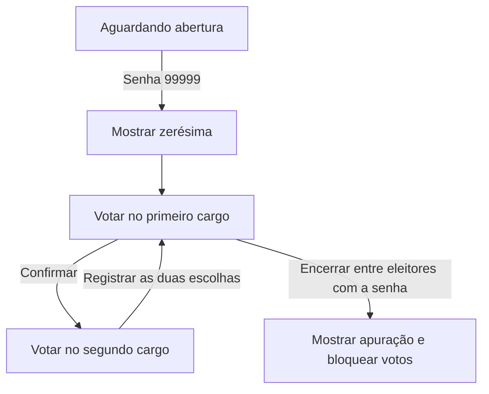

# 7. Do exemplo ao trabalho de vocês

[Voltar ao roteiro](https://github.com/NirtonAfonso/Tutorial-Firebase/wiki) · [Aula anterior](https://github.com/NirtonAfonso/Tutorial-Firebase/wiki/JavaFX)

**Arquivos desta prática** · [Exemplo Java comum](https://github.com/NirtonAfonso/Tutorial-Firebase/tree/main/exemplos/java-comum/07-apuracao) · [Exemplo Maven](https://github.com/NirtonAfonso/Tutorial-Firebase/tree/main/exemplos/maven/07-apuracao).

## Uma linha do relatório começa bem antes da tabela

A **zerésima** apresenta a situação inicial. Ela precisa mostrar também o candidato que recebeu zero votos. Por isso, comecem pelo cadastro de opções e atribuam zero a cada linha. Depois percorram as escolhas confirmadas daquele cargo e incrementem a linha correspondente. Se montarem as linhas a partir dos votos que já chegaram, a zerésima ficará vazia e candidatos sem votos desaparecerão do resultado.

Abram a pasta **07-apuracao** da trilha escolhida. Em Java comum, executem `java src/Apuracao.java`. Em Maven, executem `mvn compile exec:java`. O programa exibe o relatório inicial e depois conta quatro escolhas fictícias para um cargo. Antes de rodar, anotem o resultado para `07, 07, BRANCO, NULO`. Confiram **50%** para `07`, **0%** para `12` e **25%** para cada uma das duas linhas restantes. Se o programa fizer divisão inteira antes de multiplicar por 100, o que acontece com uma linha que recebeu apenas um voto?


Na imagem, identifiquem os títulos das colunas e o conteúdo de uma linha. Para a urna, usem colunas como **Candidato, Número, Votos e Percentual**. Mantenham o cálculo em um método que possa ser testado pelo console. A tabela da nova janela recebe o resultado já calculado. [Exemplo oficial de JTable da Oracle](https://docs.oracle.com/javase/tutorial/uiswing/components/table.html).

Rodar o exemplo é o começo. No trabalho de vocês, a mesma pessoa vota em **dois cargos**, a urna tem abertura e encerramento e o resultado fica separado por cargo. Vou usar `vereador → prefeito` nos exemplos abaixo. Na AV3, as opções do enunciado são **vereador e prefeito** ou **governador e presidente**, sem segundo turno. Na extensão, escolham **um cargo proporcional e um majoritário** e usem candidatos e partidos fictícios.

Podem seguir pelo [projeto Java comum](https://github.com/NirtonAfonso/Tutorial-Firebase/wiki/Projeto-Java-comum) ou pelo [projeto Maven](https://github.com/NirtonAfonso/Tutorial-Firebase/wiki/Projeto-Maven). Na documentação da equipe, registrem o caminho que escolheram, a versão do JDK e a configuração de conexão que outra pessoa precisa para executar o simulador.

## O que conferir no simulador

| Parte | O que o grupo deve demonstrar |
| --- | --- |
| Abertura | Bloquear a votação até digitar e confirmar `99999`. Exibir a **zerésima** dos dois cargos, com todos os candidatos, brancos e nulos em zero. |
| Interface | Teclado numérico e teclas **BRANCO**, **CORRIGE** e **CONFIRMA**. Exibir número, nome, sigla do partido e foto quando todos os dígitos do cargo forem preenchidos. |
| Tipos de voto | Confirmar candidato válido, confirmar branco, corrigir uma escolha e confirmar nulo depois do aviso de número inexistente. |
| Dois cargos | Votar no primeiro, passar ao segundo depois da confirmação e voltar ao começo após completar a votação. Limpar a foto e os dados entre os cargos e entre eleitores. |
| Persistência | Usar Firebase. Abram o console durante os testes e confirmem a gravação. No projeto de extensão, o enunciado especifica Cloud Firestore. |
| Encerramento | Pedir e confirmar `99999` antes de finalizar. Bloquear novos votos depois do encerramento. |
| Apuração | Mostrar uma nova janela com candidato, número, percentual e votos, além de brancos e nulos, em cada cargo. |
| POO | Organizar classes, pacotes e responsabilidades. Mostrem no código encapsulamento, abstração e polimorfismo. Na extensão, o enunciado também menciona herança. |

## Uma ordem para implementar

1. Criem o cadastro de cada cargo e definam quantos dígitos ele exige. No exemplo vereador → prefeito, trabalhem com cinco dígitos no primeiro e dois no segundo. No código de treino o visor tem dois espaços definidos na tela. No trabalho, façam a quantidade depender do cargo ativo.
2. Criem uma classe para o estado da eleição. Comecem com `AGUARDANDO_ABERTURA`, `EM_VOTACAO` e `ENCERRADA`. Separem a ação administrativa do teclado do eleitor. Usem um diálogo de senha como `JPasswordField` com a senha do enunciado. Essa senha faz parte da simulação.
3. Ao abrir, escolham um ID novo para a eleição e garantam que a contagem daquele ID começa em zero. A zerésima deve incluir todos os nomes, mesmo os que ainda não têm registro de voto, e listar brancos e nulos.
4. Durante a votação, guardem a etapa do cargo e a escolha em curso. Assim que a pessoa confirmar um cargo, preparem a tela do próximo. Ao concluir os dois cargos, permitam a próxima votação. Se o envio final falhar, mantenham o estado e tratem a repetição.
5. Usem um documento por sessão de voto com as duas escolhas, ou duas gravações no mesmo batch. Usem IDs fixos durante novas tentativas. Nenhum registro precisa identificar o eleitor.
6. Quando a eleição for encerrada, busquem os dados daquela eleição. Depois, agrupem pelo cargo e contem os votos por candidato e por tipo. Em Swing, montem uma janela de apuração com, por exemplo, um `JTabbedPane` com uma aba por cargo e uma `JTable` para as linhas do relatório.



Se quiserem direcionar a modelagem, pensem em `Candidato`, `Cargo`, `Voto` e `Eleicao`. A tela chama métodos da eleição e do painel. O repositório conversa com o banco. Para praticar herança com um motivo, uma opção é uma classe `Cargo` com subclasses que definem regras diferentes de quantidade de dígitos, caso a equipe precise dessas regras. Para dados simples, uma configuração por cargo também resolve a quantidade. Usem os conceitos de POO de forma que consigam explicar as escolhas na apresentação.

### Um modelo possível no Firestore

| Caminho | Exemplo de campos |
| --- | --- |
| `eleicoes/{idEleicao}` | `estado`, `cargos` e datas de abertura ou encerramento. |
| `eleicoes/{idEleicao}/candidatos/{cargo}-{numero}` | `cargo`, `numero` como string, `nome`, `partido`, `foto`. |
| `eleicoes/{idEleicao}/votos/{idSessao}` | As duas escolhas da sessão, com cargo, tipo e número. Para branco, deixem o número vazio. |

Esse modelo é uma sugestão de implementação. Com uma coleção por eleição fica mais fácil produzir a zerésima e apurar só a eleição selecionada. Se a equipe decidir usar várias urnas simultâneas, a gravação e a verificação de que a eleição ainda está aberta precisam respeitar o mesmo estado no banco. Para um único computador, comecem garantindo a sequência e a recuperação de uma falha antes de ampliar o projeto.

### Calcular o relatório por cargo

O enunciado fornece o formato das linhas. Para programar, a sugestão é usar o total de confirmações do cargo como denominador, incluindo brancos e nulos, e manter esse critério em todo o relatório. Exemplo para um cargo com dez votos.

| Linha | Votos | Percentual |
| --- | ---: | ---: |
| Júlia Horizonte (07) | 5 | 50% |
| Rafael das Nuvens (12) | 3 | 30% |
| Votos brancos | 1 | 10% |
| Votos nulos | 1 | 10% |

```java
double percentual = totalDoCargo == 0 ? 0.0 : 100.0 * votosDaLinha / totalDoCargo;
```

O `100.0` faz o cálculo em ponto flutuante. Com dez votos e uma linha com três, `votosDaLinha / totalDoCargo` usando apenas inteiros pode dar zero. Na apresentação, escolham o número de casas decimais e indiquem qual total foi usado.

## Testem antes de enviar

| Teste | Resultado esperado |
| --- | --- |
| Tentar votar antes da abertura ou usar senha errada | Votação bloqueada. |
| Abrir com `99999` | Zerésima dos dois cargos. |
| Digitar parcialmente um número e tentar confirmar | Sem voto registrado. |
| Completar um número válido e apertar CORRIGE | Dados e foto aparecem e depois somem. |
| Confirmar um número inexistente e confirmar em branco em outro cargo | O relatório distingue nulo de branco. |
| Votar nos dois cargos com números válidos | Os dois votos ficam na eleição certa. |
| Simular falha no envio e tentar novamente | A tela informa a falha e a tentativa mantém o ID. A contagem não duplica. |
| Encerrar após uma votação completa | A nova janela mostra os dois cargos e a urna fica bloqueada. |
| Encerrar uma eleição sem votos | Todos aparecem com zero, sem divisão por zero. |
| Abrir o projeto em outra máquina | Fotos, README e modelo do `.env` estão disponíveis. Se usarem Maven, confiram o POM. Se usarem Java comum, indiquem os JARs e como adicioná-los. Segredos ficam fora do Git. |

## Orientações de cada turma

| Turma | Confiram no enunciado |
| --- | --- |
| **Manhã · Extensão Urna Cidadã** | Grupos de até 5. Além do simulador, confiram o cronograma do Desafio 1, a correlação com os ODS 16 e 4 no Desafio 2 e o relatório do Desafio 3 conforme o modelo institucional. O cronograma estabelece **30/11/2026** como prazo no Canvas. O projeto prevê material educativo sobre desinformação e deepfakes, oficina e avaliação da percepção dos participantes. |
| **Noite · AV3** | Individual ou grupo de até 5. Enviem **o link do GitHub pelo Canvas até 18h de 04/12/2026**. As apresentações começam às **19h**. Todos devem estar presentes e entender a implementação. O enunciado informa sorteio da ordem e de quem apresenta pelo grupo. |

No README do grupo, incluam o que a urna faz, como executar, como configurar o laboratório com valores de exemplo e como reproduzir os testes principais. Antes da apresentação, cada integrante deve conseguir explicar o caminho desde o clique em CONFIRMA até o registro no Firebase.

[Simulador de votação do TSE](https://www.tse.jus.br/hotsites/simulador-de-votacao/)
