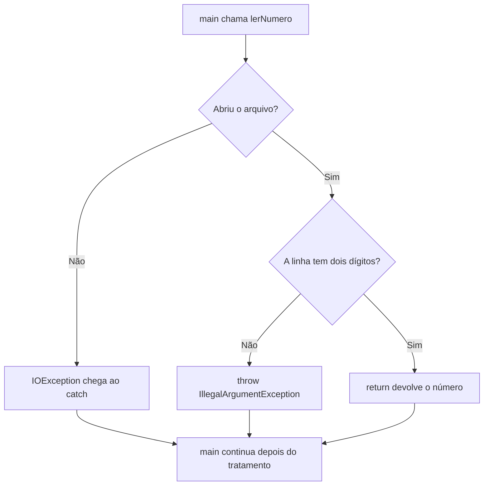

# 3. Tratando erros sem travar a urna

[Voltar ao roteiro](https://github.com/NirtonAfonso/Tutorial-Firebase/wiki) · [Aula anterior](https://github.com/NirtonAfonso/Tutorial-Firebase/wiki/Swing-e-fotos) · [Próxima aula: Firestore](https://github.com/NirtonAfonso/Tutorial-Firebase/wiki/Banco-no-Firebase)

**Arquivos desta prática** · [Exemplo Java comum](https://github.com/NirtonAfonso/Tutorial-Firebase/tree/main/exemplos/java-comum/03-excecoes) · [Exemplo Maven](https://github.com/NirtonAfonso/Tutorial-Firebase/tree/main/exemplos/maven/03-excecoes).

## O que é uma exceção e para onde ela vai?

Pensem na chamada `main → lerNumero → abrir arquivo`. Normalmente cada método termina e devolve o controle a quem o chamou. Se o arquivo sumiu, o método que tenta abri-lo cria uma **exceção**, um objeto que descreve a falha. O Java interrompe as instruções restantes daquele caminho e procura um `catch` compatível. Quando o método atual não tem esse tratamento, a busca continua em quem o chamou. Essa sequência de chamadas é a **pilha**.

Leiam a figura de baixo para cima para reconstruir quem chamou quem. Ao investigar um *stack trace* no console, procurem o tipo da exceção e a primeira linha do código de vocês, identificada por arquivo e número de linha. Quando houver `Caused by`, leiam a causa original também. [Figura e explicação da Oracle](https://docs.oracle.com/javase/tutorial/essential/exceptions/definition.html).

**Façam três execuções.** O arquivo `candidato.txt` acompanha o exemplo e contém `07`. Na pasta do exemplo, executem `java src/ExemploLeitura.java` no Java comum ou `mvn compile exec:java` no Maven. O resultado começa com `Número lido: 07`. Troquem a primeira linha por `7` e rodem novamente. Depois, renomeiem o arquivo para `candidato-reserva.txt` e rodem pela terceira vez. Devolvam o nome e o conteúdo originais depois da experiência.

| O que aconteceu | Quem identifica | Como a execução termina |
| --- | --- | --- |
| A leitura devolveu `07` | O método aceita a linha e faz `return`. | O console mostra o número e depois `Fim da leitura.`. |
| O arquivo contém `7` | Nosso método lança `IllegalArgumentException` com orientação sobre o formato. | O `catch` mostra a orientação, e o programa continua. |
| O arquivo sumiu | O JDK lança `NoSuchFileException`, uma subclasse de `IOException`. | O tratamento específico informa qual arquivo faltou. |

Reparem na ordem dos `catch` no fonte. A falha de arquivo ausente é uma forma específica de falha de entrada e saída. Se colocarem o tratamento mais geral antes do específico, o compilador aponta que o segundo já está coberto. Em `try (BufferedReader ...)`, o leitor é fechado tanto no retorno normal quanto quando a validação lança a exceção.

Imaginem que alguém digitou `99`. Se esse número não estiver cadastrado, a urna sabe exatamente o que fazer: mostra o aviso e só registra o voto como nulo se a pessoa confirmar. Agora imaginem que o Firestore parou de responder depois que a pessoa apertou CONFIRMA. Aí a urna precisa avisar que não recebeu a confirmação do banco. São situações diferentes e pedem respostas diferentes.

## O que o Java oferece

| Recurso | Como aparece na prática |
| --- | --- |
| `try` e `catch` | Tentem abrir um arquivo. Se ele não puder ser lido, tratem a `IOException`. |
| `throw` | Lancem uma exceção quando o método receber algo que ele não consegue aceitar. |
| `throws` | Avisem na assinatura que a falha pode chegar a quem chamou o método. |
| `finally` | Executem uma ação de limpeza mesmo quando houve falha. Por exemplo, restaurem um botão depois de uma operação. |
| `try (var recurso = ...)` | Fechem automaticamente arquivos ou outros recursos `AutoCloseable`, inclusive quando o bloco falha. |

`IOException` e a nossa `PersistenciaException` são verificadas pelo compilador. Quem chama um método que as declara precisa capturar ou declarar a exceção também. `IllegalArgumentException` é um exemplo de exceção não verificada. No roteiro usamos quando recebemos um número ou campo de candidato fora do formato esperado.

Voltem a `ExemploLeitura.java` e localizem o método que declara `throws IOException`. Se vocês tirarem o tratamento da chamada em `main`, o compilador passa a exigir que alguém assuma essa responsabilidade. Restaurem o código antes do próximo teste.

## Como decidir o que mostrar

| Situação | Tratamento na urna |
| --- | --- |
| Faltam dígitos | Deixem CONFIRMA desabilitado. |
| O número completo não existe | Mostrem o aviso e, se confirmado, salvem como nulo. |
| O número existe e o PNG está ausente | Mostrem os dados, coloquem “Sem foto” e corrijam o arquivo antes da entrega. |
| A senha administrativa está errada | Mostrem uma mensagem e preservem a etapa atual da eleição. |
| O banco caiu ou demorou demais | Mantenham o voto a confirmar. Registrem o erro e deixem tentar o mesmo envio. |
| O `.env` está ausente | A urna conectada avisa na abertura. Confiram o diretório de execução antes de alterar o código. |

### Onde capturar os erros do Firestore

O tratamento na tela é o mesmo para quem está em Java comum e para quem está usando Maven. Na [conexão REST](https://github.com/NirtonAfonso/Tutorial-Firebase/wiki/Firestore-sem-Maven), o proxy trata a resposta HTTP, o tempo de espera e a interrupção da requisição. Na [conexão pelo Admin SDK](https://github.com/NirtonAfonso/Tutorial-Firebase/wiki/Firestore-com-Maven), o proxy trata o resultado da operação enviada pelo SDK. Os dois entregam à tela uma `PersistenciaException` quando a gravação falha.

A [classe FirestoreProxy](https://github.com/NirtonAfonso/Tutorial-Firebase/blob/main/exemplos/maven/05-firestore/src/main/java/br/edu/urna/dados/FirestoreProxy.java) espera no máximo dez segundos pela resposta de cada chamada. Ela traduz a falha do SDK para [PersistenciaException](https://github.com/NirtonAfonso/Tutorial-Firebase/blob/main/exemplos/java-comum/02-swing-e-fotos/src/br/edu/urna/dados/PersistenciaException.java), guardando a causa. Se a operação for interrompida, o código restaura o sinal com `Thread.currentThread().interrupt()` antes de propagar a falha.

No [PainelSwing](https://github.com/NirtonAfonso/Tutorial-Firebase/blob/main/exemplos/java-comum/02-swing-e-fotos/src/br/edu/urna/swing/PainelSwing.java), o `SwingWorker` faz a gravação em `doInBackground()` e devolve o controle para a tela em `done()`. Se o grupo chamar o banco diretamente dentro de `actionPerformed`, a janela pode ficar sem responder enquanto espera. Em `done()`, `get()` sinaliza se o trabalho terminou com sucesso ou lançou uma exceção. O visor só avança depois do sucesso.

Se a internet cair depois de o banco ter recebido a gravação, o aplicativo pode não ter recebido a resposta. Por isso a tentativa seguinte preserva o **mesmo ID e o mesmo conteúdo**. O exemplo bloqueia a edição enquanto existe dúvida sobre esse envio. Esse cuidado protege a repetição dentro da sessão aberta. Para retomar uma confirmação após fechar o aplicativo, o grupo teria que guardar o ID da operação de forma durável e reconciliar o estado.

Evitem `catch (Exception e) {}`. Quando acontece alguma coisa, fica difícil descobrir se o programa salvou o voto. Exibam uma mensagem que faça sentido para quem está na urna e guardem a causa técnica no log. Antes de compartilhar um log ou print para pedir ajuda, retirem credenciais e informações locais sensíveis.

**Para praticar.** Na urna em memória, troquem temporariamente o nome de um PNG cadastrado. Na aula de Firebase, façam uma cópia local do `.env` fora do projeto e testem com um caminho de arquivo que não existe. Observem em qual ponto cada problema aparece e restaurem o caminho correto depois.

Referências [Exceções no Java](https://dev.java/learn/exceptions/) · [SwingWorker](https://docs.oracle.com/javase/tutorial/uiswing/concurrency/worker.html).
